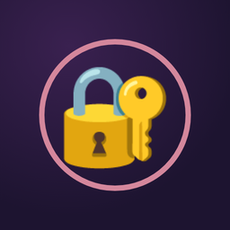
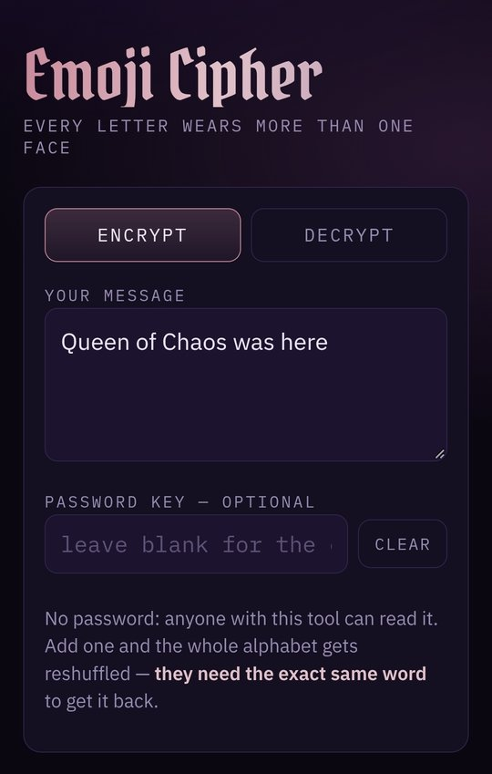
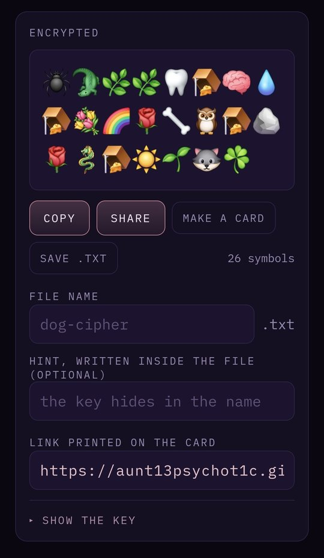
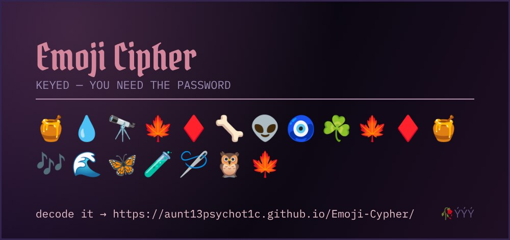

  

<h1 align="center">🔐 Emoji Cipher 🔐</h1>

<i>every letter wears more than one face</i>

  
  
  
  

---

Turn any message into a string of emoji, then turn it right back. Lock it with a secret word so only your people can read it, hide a hint in the file name, and send it off as text, a file, or a pretty little card. 🌹

Passing notes, Discord games, puzzles, treasure hunts, or just confusing your friends. This is the tool.

## 👀 See it in action

  
  &nbsp;&nbsp;
  

<b>Type it</b> ✍️ &nbsp;→&nbsp; <b>Watch it turn into emoji</b> 🪄

  

<b>Make a card</b> 🃏 and send it anywhere. The decode link is printed right on it.

## ✨ What it does

| | |
|---|---|
| 🎭 **Every letter has 3 faces** | Each letter gets a random pick from 3 different emoji, so the same word looks different every time you code it |
| 🗝️ **Secret word lock** | Add a password and the whole emoji alphabet reshuffles. Only someone with the exact same word can read it |
| 🙈 **No peeking at word lengths** | Spaces get turned into emoji too, so nobody can count the words |
| 🃏 **Shareable cards** | One tap makes a picture of your message with the decode link on it |
| 📤 **Share** | Sends your message as text *and* a file, straight to texts, Discord, email, wherever |
| 💾 **Save as .txt** | Name the file whatever you want and tuck a hint inside |
| 🔑 **Show the key** | Peek at the full emoji alphabet for your secret word |
| 📴 **Works offline** | Everything happens on your device. Nothing gets sent anywhere |

## 🕵️ Play the treasure hunt

The sneaky way to use it:

1. Type your message and lock it with a secret word, like **dog** 🐕
2. Name the file **dog-cipher**
3. In the hint box, write **"the key hides in the name"** 😏
4. Hit **Save .txt** or **Share**

Now your friend gets `dog-cipher.txt`, reads the hint, and has to figure out the key is sitting right there in the file name. 🧩

> Heads up: some apps, like Facebook Messenger, rename files when you send them, which wipes the clue. Email, Drive and Discord keep the name.

## 📱 Get it

**In your browser:** just open **[aunt13psychot1c.github.io/Emoji-Cypher](https://aunt13psychot1c.github.io/Emoji-Cypher/)**. Nothing to install.

**As an Android app:**
1. Open the **[latest release](https://github.com/Aunt13psychot1c/Emoji-Cypher/releases/latest)** and tap the file ending in **.apk**
2. Open the download and tap **Install**
3. If your phone says your browser isn't allowed to install apps, tap **Settings**, switch on **Allow from this source**, go back, and tap **Install**

New versions install right over the old one.

## 🧠 How it works (for the curious)

- The cipher covers **A to Z, 0 to 9, spaces, and `. , ! ? ' " - : ; ( ) /`**. Anything else (line breaks, other alphabets) passes through as is.
- Each character maps to **3 emoji**, and one is picked at random every time, so the same message never looks the same twice.
- Your secret word seeds a shuffle of the whole emoji alphabet. **Same word in, same shuffle out**, on any device, so you and your friend never have to swap the key table itself. (Under the hood: an xmur3 seed feeding an sfc32 random number generator.)
- The whole web version is **one single file**, `index.html`. No server, no build step, no tracking. The Android app wraps that same file using Capacitor.

## ⚠️ Not for real secrets

This is a substitution cipher wearing emoji. It's fun and it's obscure, but someone determined, with enough coded text, could crack it with letter-frequency tricks like any classic substitution cipher.

Use it for puzzles, games and passing notes. **Don't** use it for passwords, money, or anything that truly needs to stay secret.

## 🛠️ Host your own

It's one self-contained file, so drop `index.html` anywhere that serves web pages. For GitHub Pages: **Settings > Pages > Deploy from branch > main / root**, and it goes live at `https://<you>.github.io/<repo>/`.

## 💜 Support

If the cipher made you smile, **[☕ buy me a coffee](https://buymeacoffee.com/aunt13psychot1c)**. It keeps the chaos running and the apps free.

---

Made with chaos by <b>Aunt13psychot1c</b>, Queen of Chaos 👑 
<a href="LICENSE">MIT License</a> · patent pending 😏

